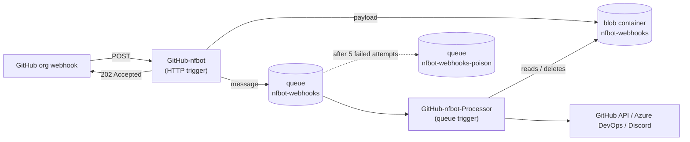

# nanoFramework GitHub bot (nfbot)

Azure Function that receives the nanoFramework GitHub organization webhooks and automates the PR and issue workflow: validating PR/issue templates, labelling, auto-merging version update PRs once checks pass, closing superseded update PRs, cleaning up branches, processing `@nfbot` commands and posting community notifications to Discord.

## Architecture



GitHub requires a response to a webhook delivery within **10 seconds** and **never retries failed deliveries**. Processing (several API calls, deliberate delays to let GitHub settle, merges, DevOps builds) can take longer than that, so reception and processing are decoupled:

1. **`GitHub-nfbot`** (HTTP trigger, anonymous `POST`)
   - Stores the raw payload in blob `nfbot-webhooks/{X-GitHub-Delivery}-{guid}.json` (payloads can exceed the 64 KB queue message limit).
   - Enqueues a message (`WebhookQueueMessage`: delivery ID, event name, blob name) on queue `nfbot-webhooks`.
   - Returns `202 Accepted`. Returns `500` only if the payload can't be stored/queued, so GitHub records it as failed and it can be redelivered.
2. **`GitHub-nfbot-Processor`** (queue trigger)
   - Loads the payload and runs the processing logic (`ProcessPayloadAsync`).
   - On success deletes the blob.
   - On failure logs the error and rethrows, so the runtime retries the message. After `maxDequeueCount` attempts the message moves to `nfbot-webhooks-poison` and the blob is kept for investigation/replay.

Retry behaviour is configured in [host.json](host.json) (`extensions.queues`): 5 attempts, 30 s between attempts, queue polled at least every 5 s.

> [!NOTE]
> A retry runs the whole processing again for that delivery. Most steps are idempotent (labels, merge, branch delete), but steps that post comments may repeat if the failure happened after them.

### Events handled

| Event | Processing |
|---|---|
| `pull_request` `opened`/`edited` | Template validation, checklist fix, labels, thank you note; bot PRs get `Type: dependencies` / `CI: Publish Release` labels |
| `pull_request` `closed` | Bot PRs: delete head branch, close older `[version update]` PRs targeting the same branch. Merged: invite first-time contributors to CONTRIBUTORS.md. Not merged: label `invalid` |
| `pull_request` `synchronize` | Cleanup of `nfbot/clang-format-fix*` branches and comments |
| `issues` | Template validation, labels, support notice; `labeled` with `up-for-grabs` (Discord) or missing project to reproduce |
| `issue_comment` `created` | `@nfbot` commands from org members: `startrelease`, `updatedependents`, `updatedependencies [all\|develop]`, `runpipeline [branch]`, `closeupdateprs` |
| `pull_request_review` approved | Merge release candidate PRs with `CI: Publish Release` and queue DevOps build |
| `check_run` / `status` success | Auto-merge bot `[version update]` / `[release candidate]` PRs when all required checks passed |
| `fork`, `star`, `sponsorship` | Discord notifications |

## Logging and troubleshooting

Each delivery is logged with its context, e.g.:

```text
Queued delivery <guid> event 'check_run' action 'completed' repo nanoframework/<repo> sha <sha> (12345 bytes) as <blob>.json.
Processing delivery <guid> event 'check_run' ... attempt 1
Completed delivery <guid> event 'check_run' ... attempt 1 in 1234ms
Failed processing delivery <guid> ... attempt 2 after 456ms: ApiException: ... | HTTP 405 MethodNotAllowed | rate limit 4321/5000, resets ...
```

For GitHub API errors the HTTP status, API error details, response body and rate limit state are included.

### Failure notifications

A card is posted to the Discord channel configured in `DISCORD_FAILURES_WEBHOOK_URL` when:

- a delivery fails its last processing attempt (it's about to move to the poison queue), or
- a delivery can't be stored/queued (HTTP trigger returns `500`).

Transient failures that succeed on a retry aren't notified. The card shows the repository, the PR/issue number and a short failure reason, and its title links straight to the PR or issue (falling back to the check run, commit or repository). The footer has the delivery ID to search the logs. If the setting is missing, notifications are skipped with a warning in the log.

- **Logs**: Function App > Monitoring (Log stream / Application Insights `traces`), filter by the delivery ID (matches `X-GitHub-Delivery` shown in the webhook *Recent Deliveries* page).
- **Permanently failed deliveries**: inspect queue `nfbot-webhooks-poison` in the storage account (Storage browser). The message contains the blob name holding the payload.
- **Replay**: move the poison message back to `nfbot-webhooks` (or re-send it with the same content), or use *Redeliver* in the GitHub org webhook *Recent Deliveries* page.

## Azure setup

| Item | Value |
|---|---|
| Function App | `NanoFramework-GitHubBot` |
| Runtime | Azure Functions v4, .NET 8 isolated worker (`FUNCTIONS_WORKER_RUNTIME=dotnet-isolated`) |
| Storage | Storage account referenced by `AzureWebJobsStorage` (queues `nfbot-webhooks`, `nfbot-webhooks-poison` and blob container `nfbot-webhooks` are created automatically on first use) |

Hosting plan, region and Application Insights resource aren't recorded in this repository; check the Function App in the Azure portal.

### Application settings

| Setting | Purpose |
|---|---|
| `AzureWebJobsStorage` | Storage account connection string (Functions runtime, queue and payload blobs) |
| `FUNCTIONS_WORKER_RUNTIME` | `dotnet-isolated` |
| `GITHUB_TOKEN` | GitHub PAT for the `nfbot` account, used by Octokit |
| `GITHUB_CREDENTIALS` | Base64 of `nfbot:<PAT>`, used for raw GitHub REST calls (basic auth) |
| `DEVOPS_PATOKEN` | Azure DevOps PAT (`https://dev.azure.com/nanoframework`) to queue builds |
| `DISCORD_WEBHOOK_URL` | Discord (Slack compatible) webhook for fork/star notifications |
| `DISCORD_CONTRIBUTIONS_WEBHOOK_URL` | Discord webhook for sponsorship notifications |
| `DISCORD_UP_FOR_GRABS_WEBHOOK_URL` | Discord webhook for `up-for-grabs` issues |
| `DISCORD_FAILURES_WEBHOOK_URL` | Discord webhook for failure notifications (see [Failure notifications](#failure-notifications)) |

### GitHub webhook

Organization webhook on `nanoframework`:

- **Payload URL**: `https://<function app host>/api/GitHub-nfbot`
- **Content type**: `application/json`
- **Events**: must include the events listed in [Events handled](#events-handled). The exact selection configured isn't recorded in this repository; check the org webhook settings.

## Deployment

Built and deployed by the [NanoFramework-GitHubBot.yml](../../.github/workflows/NanoFramework-GitHubBot.yml) workflow on pushes to `main` touching `github-nfbot/GitHub-nfbot/**`, using the publish profile stored in the `NANOFRAMEWORK_GITHUBBOT_FFFF` repository secret.

## Local debugging

- Settings are read from `local.settings.json` (not committed) and/or [user secrets](https://learn.microsoft.com/aspnet/core/security/app-secrets) (`UserSecretsId` in the project).
- For the queue/blob storage run [Azurite](https://learn.microsoft.com/azure/storage/common/storage-use-azurite) and set `AzureWebJobsStorage` to `UseDevelopmentStorage=true`.
- Start with `func start` (or F5 in Visual Studio) and post a payload to `http://localhost:7071/api/GitHub-nfbot` with headers `X-GitHub-Event` and `X-GitHub-Delivery`.
